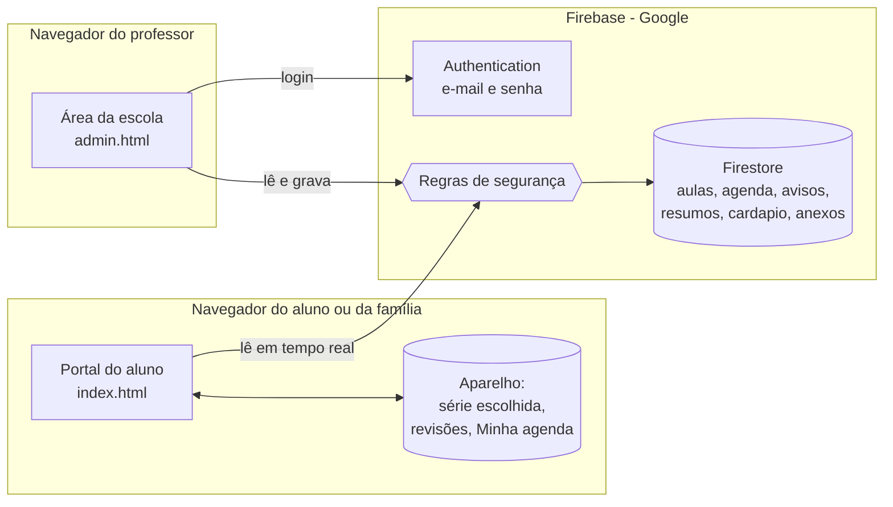

# Arquitetura do Portal do Aluno

Este documento explica como o portal é construído, onde ficam os dados, como ele se protege e até onde aguenta no plano gratuito. Serve para a escola avaliar se o projeto é aplicável na realidade dela.

## Visão geral

O portal é um **site estático** (HTML, CSS e JavaScript, sem servidor próprio) que conversa direto com o **Firebase**, um serviço do Google:

- **Firestore** guarda os dados (horário, provas, avisos, resumos, cardápio e anexos).
- **Firebase Authentication** faz o login dos professores.

O site pode ser hospedado de graça (GitHub Pages ou Firebase Hosting). Não há servidor para manter, atualizar ou pagar.

## Organização do código

| Arquivo | Papel |
|---|---|
| `index.html` / `js/portal.js` | Portal do aluno: só lê dados publicados |
| `admin.html` / `js/admin.js` | Área da escola: login e publicação |
| `js/config.js` | **Único arquivo que a escola edita**: Firebase, nome, séries, horários e disciplinas |
| `js/dados.js` | Única camada que fala com o Firestore. O resto do site não conhece o banco |
| `js/anexos.js` | Prepara e guarda imagens e PDFs (reduz fotos e converte o PDF do cardápio em imagem) |
| `js/estudo.js` | Revisão espaçada e perguntas dos resumos (fica no aparelho do aluno) |
| `js/foco.js` | Cronômetro de estudo (25 + 5 minutos) |
| `js/ui.js` | Funções de tela reaproveitadas (datas, criação segura de elementos, avisos) |
| `firestore.rules` | Regras de segurança do banco |
| `testes/` | Testes automáticos (abrir `testes/index.html` no navegador) |
| `ferramentas/exemplo.html` | Carrega e apaga dados fictícios para demonstração |

## Modelo de dados

| Coleção | Campos principais | Quem vê |
|---|---|---|
| `aulas` | série, dia, horário, disciplina | Alunos da série |
| `agenda` | série (ou "Todas"), data, tipo (Prova, Entrega, Evento, Feriado), disciplina, descrição | Alunos da série |
| `avisos` | série (ou "Todas"), título, texto, data de publicação | Alunos da série |
| `resumos` | série, disciplina, data da aula, assunto, resumo, perguntas, link, referência do anexo | Alunos da série |
| `cardapio` | dia e pratos, ou a imagem da semana | Todos |
| `anexos` | nome, tipo e o arquivo (imagem ou PDF) | Todos, só quando abrem o anexo |
| `admins` | um documento por professor liberado | Só o próprio professor |

Os anexos ficam numa coleção separada de propósito: a lista de resumos carrega rápido e o arquivo só é baixado quando o aluno abre o anexo.

## Segurança

- **Leitura pública, escrita restrita.** Qualquer pessoa lê o conteúdo publicado. Só grava quem está logado **e** tem um documento na coleção `admins`. Essa liberação é feita à mão pela coordenação no console do Firebase.
- **Testado no banco real.** Com uma conexão sem login, todas as tentativas de gravação nas 8 coleções foram negadas (`permission-denied`), e a leitura da lista de professores também.
- **Nada do banco vira código.** Todo texto entra na página como texto puro (`textContent`), nunca como HTML. Um aviso com código malicioso aparece como texto e não executa (há teste automático para isso). Links só são aceitos se começarem com `http://` ou `https://`.
- **A chave do Firebase no `config.js` não é segredo.** Ela identifica o projeto. Quem protege os dados são as regras do Firestore.

## Privacidade (LGPD)

- O aluno **não cria conta** e não informa nenhum dado pessoal.
- O que o aluno marca (série, resumos estudados, revisões e Minha agenda) fica **só no navegador do aparelho dele**. Não vai para o banco e ninguém mais vê.
- O banco guarda apenas conteúdo escolar publicado pelos professores e o e-mail de login de cada professor.

## Limites do plano gratuito (Firebase Spark)

| Recurso | Limite diário gratuito | Uso estimado |
|---|---|---|
| Leituras | 50.000 por dia | Cerca de 70 leituras por visita no início do semestre e cerca de 300 no fim, quando há mais resumos |
| Gravações | 20.000 por dia | Dezenas por dia (professores publicando) |
| Armazenamento | 1 GB | Uma foto reduzida tem 100 a 300 KB: cabem milhares de anexos |

**O que isso significa:** entre **170 e 700 visitas por dia** sem custo. Uma escola de 300 alunos em que um terço acessa todo dia fica com folga.

**Se crescer além disso:**
1. Mudar para o plano Blaze (pago por uso). O custo é de aproximadamente **US$ 0,06 a cada 100 mil leituras**, ou seja, centavos por mês nessa escala.
2. Ou carregar os resumos por página (só os mais recentes primeiro), o que reduz as leituras por visita.

**Limite de anexo:** cada anexo tem até 700 KB, porque o Firestore aceita até 1 MB por documento. Fotos são reduzidas automaticamente e o PDF do cardápio vira imagem. PDFs maiores podem ir para o Google Drive e entrar pelo campo de link.

## Funcionamento técnico

- **Tempo real:** o portal escuta o banco. Quando o professor publica, a página do aluno se atualiza sozinha, sem recarregar.
- **Horário salvo em lote:** o quadro de horários grava todas as mudanças numa única operação. Ou entra tudo, ou nada.
- **Sem dependências para instalar:** o Firebase e o leitor de PDF vêm de CDNs oficiais. O leitor de PDF só é baixado quando um professor envia um PDF de cardápio.
- **Acessibilidade:** navegação por teclado, rótulos em todos os campos, link "Pular para o conteúdo", contraste adequado e layout que funciona em celular de 375 px.

## Testes

A pasta `testes/` tem 42 testes automáticos, que rodam no navegador abrindo `testes/index.html` e clicando em "Rodar os testes". Eles abrem as páginas reais com um banco falso em memória, então nada é gravado no Firebase. Cobrem:

- **Funções de apoio:** datas, ordenação de horários, perguntas e revisão espaçada.
- **Anexos:** redução de fotos, limite de PDF, tipos recusados e conversão do PDF do cardápio.
- **Portal do aluno:** cada seção, troca de série, filtros, teste de perguntas, revisões, proteção contra código malicioso e tela de celular.
- **Área da escola:** login, conta sem permissão, quadro de horários (editar, colar da planilha, validações, remover linha, aviso de alterações não salvas), cadastro com campos obrigatórios, editar, duplicar, excluir, anexos e erro de permissão.
- **Dados de exemplo:** a ferramenta preenche as nove séries e apaga só o que é de exemplo.

## Dados de demonstração

`ferramentas/exemplo.html` preenche o portal com conteúdo fictício para as nove séries: horário completo, provas com conteúdo, avisos, cerca de dez resumos com perguntas por série (alguns com imagem) e cardápio. Cada item é gravado com `exemplo: true`, e o botão "Apagar dados de exemplo" remove só esses itens. A ferramenta exige o login de professor e grava cerca de 400 itens, bem abaixo do limite diário de gravações do plano gratuito.

## Como colocar uma escola nova no ar

1. Criar um projeto no Firebase e ativar o Firestore e o login por e-mail e senha.
2. Colar a configuração do projeto em `js/config.js` e ajustar o nome da escola, as séries e os horários.
3. Publicar o conteúdo de `firestore.rules` em Firestore → Regras.
4. Criar a conta de cada professor em Authentication e um documento com o ID dela na coleção `admins`.
5. Publicar a pasta do site no GitHub Pages ou no Firebase Hosting.
